# ChoomCity

Choom-op is my co-op mod for Cyberpunk 2077 on PC. Bring your own V, hop in a car with a friend, and go explore Night City together.

**[Get v0.7.7 for Windows](https://github.com/Mackaboi/ChoomCity-Releases/releases/tag/v0.7.7)** · [All builds](https://github.com/Mackaboi/ChoomCity-Releases/releases) · [Report a bug](https://github.com/Mackaboi/ChoomCity-Releases/issues)

> [!WARNING]
> **This is still very early and experimental.** I’m still working on it, so expect some bugs.

## Inside ChoomCity

- **Host or join from CHOOMCITY.** It’s in the main menu and pause menu. Join with a Steam invite, a code, or an IP address.
- **Play as your own V.** Your friends can see what you’re wearing, what gun you’re holding, and what you’re doing. Face sync is still experimental.
- **Ride shotgun.** Get in the same car as your friend and shoot from the passenger seat.
- **Explore together.** Stick close to the host to see their traffic, pedestrians, and enemies. Time and weather follow the host too.
- **Keep your own save.** Everyone loads their own V. Co-op saves are kept separately for each host, and if you’re at the same point in the story, you can vote on dialogue choices.

## Get into Night City

1. Download **`ChoomLauncher.exe`** from the release page and run it. The launcher looks for your game automatically.
2. In the launcher, open **Mods** and select **Download everything** to install Choom-op and its dependencies. The launcher can update both itself and the mod.
3. Start Cyberpunk 2077, open **CHOOMCITY**, and host or join a session.

**Manual install** · Install RED4ext, Cyber Engine Tweaks, and redscript, then extract `CoopMod-*.zip` into your Cyberpunk 2077 folder. Native Settings UI is optional.

## Good to know

- **Can’t connect?** Even with a Steam invite, you’re connecting directly to the host. If automatic port mapping fails, the host can forward UDP port 7777 or use Tailscale.
- **Stay near the host.** NPCs sync within 150 m by default and can still act differently on each player’s screen.
- **Doing story missions?** Start from the same point. The optional journal setting copies quest objectives, but each game still runs its own quests.
- **Back up your saves.** If you manually save over a solo save while playing co-op, it’ll still overwrite that save.
- **Save or face acting up?** If **Continue my game** gets stuck, try Cyberpunk’s regular **Continue** button. If a friend’s face looks off, turn off **Show friends’ faces**.

## If something goes wrong

**Press F10** during a session to see ping, packet loss, and how much time the mod is taking each frame.

If you hit a bug, go to **CHOOMCITY → Help → Copy problem report** and paste it into a [GitHub issue](https://github.com/Mackaboi/ChoomCity-Releases/issues). A quick note about what you and your friend were doing helps. If it’s lag or desync, attach `coop_stats.log` if you have it.
